# Metric Filter

O Metric Filter é um recurso do Amazon CloudWatch que analisa os eventos armazenados no CloudWatch Logs, identifica mensagens que correspondem a um padrão definido e transforma essas ocorrências em métricas numéricas.

Ele permite converter registros de texto em dados que podem ser monitorados por métricas e alarmes.

Exemplo prático no projeto:
(Você quer fazer um alarme que é disparado sempre que algum usuario erra a senha).

O RDS registra um Log  como:

```
Access denied for user 'admin'@'172.31.36.49'
```

O filtro utiliza o padrão (Ele vai buscando " equals " nos logs):

```
"Access denied for user"
```

Quando encontra uma mensagem correspondente, registra o valor `1` na métrica `FailedLoginAttempts`. Assim, cada evento identificado contribui para a contagem das falhas de autenticação.

**Exemplo:**
Uma pessoa errou a senha +1
Ourta errou +1
Regra =  Se passar de 2 tentativas dispara o alarme.

Por que ele é importante?

- Automatiza a identificação de eventos específicos nos logs.
- Transforma mensagens de texto em métricas mensuráveis.
- Permite criar alarmes baseados em limites ou frequências de eventos.
- Facilita o monitoramento de erros, falhas de autenticação e outros eventos de segurança.

## Criando um filtro de metrica / Log
Será criado um filtro que se tiver 3 erros de senha em um determinado periodo, é disparado um alarme no SNS.

**Fluxo:**
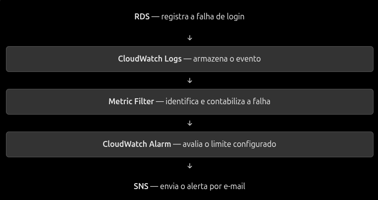

1. Sempre que você habilitar os Logs em um rds ou em outro serviço que seja (dependendo do serviço será necessário mais configurações como IAM Role e etc...), os mesmos já serão enviados para o CloudWatch.
Como primeiro passo, é necessário verificar se os Logs estão sendo devidamente enviados ao CloudWatch, principalmente o desejado.
(Simule erros para teste).

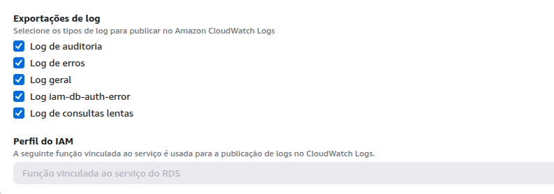


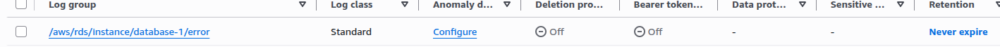

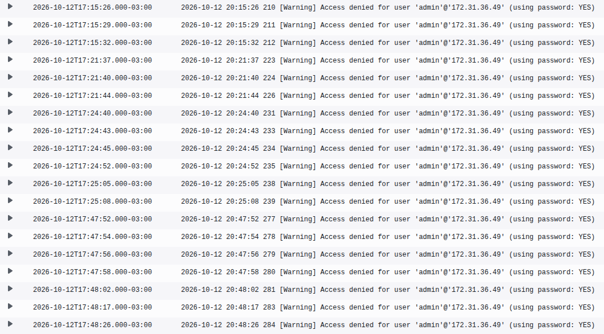

2. O segundo passo é criar o filtro:
-    Filter pattern: Você deve colocar o que será procurado, ex: "Access denied"
  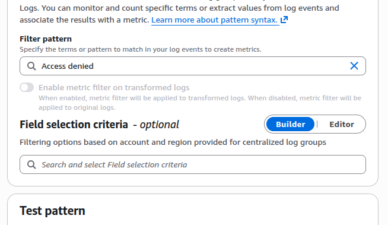

- Após isso, você deve testar se a regra está funcionando no banco de dados alvo apertando em "Test pattern"
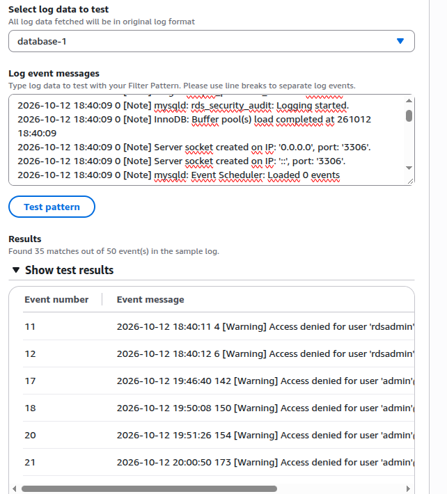

- Filter Name: Nome do seu filtro.
  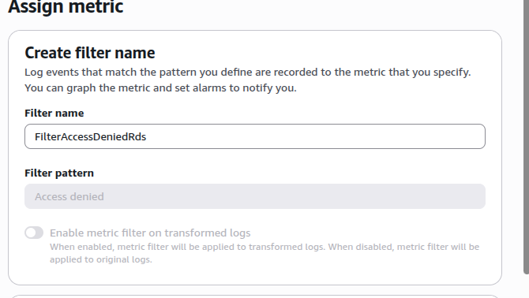

  - Metric namespace: Aqui temos que ter atenção, pois é necessário criar um ambiente separado aonde estes Logs irão ficar centralizados.
Obs: Pode ser usado o default(Cwagent), mas pode vir a gerar erros.
- Metric name: O nome de suas métricas.
- Metric value: Quanto ela irá valer (Se for encontrada).
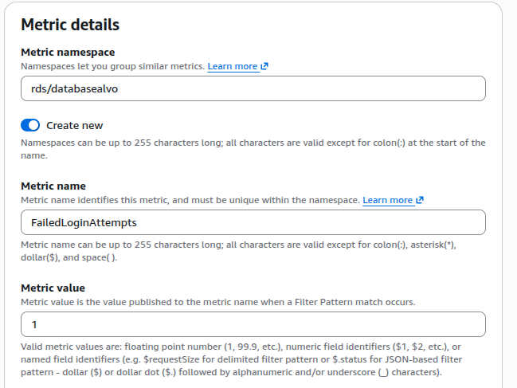

## Criando o alarme:

1. Abra o CloudWatch na sessão de alarmes e crie um conforme especificado abaixo:
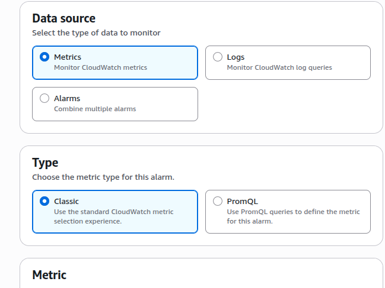

2. Em select metric, procure seu namspace e dentro do mesmo, selecione a metric name que você criou acima:
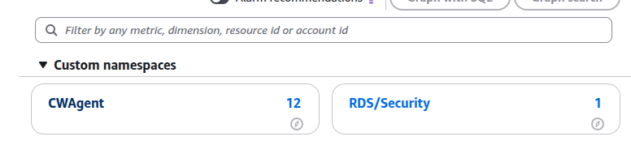

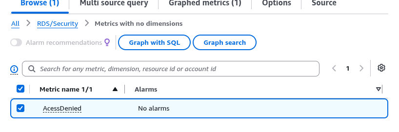

IMPORTANTE:
- Se seu namespace não aparecer, é porque não tem métricas para o mesmo analisar. Quando você cria o namespace, ele só começa a contabilizar as criadas daquele momento para frente, então se não aparecer o namespace, simule Logs (Baseado na regra que você colocou, no caso Access denied) e atualize a página até aparecer.

3. Personalize para seu uso:
   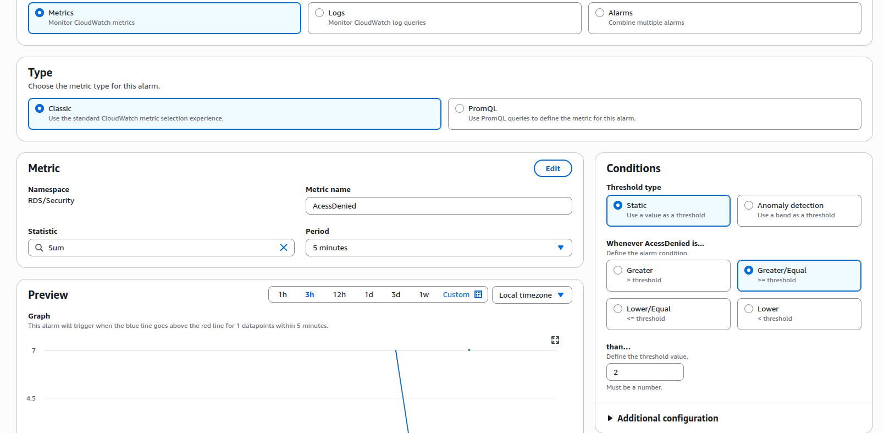

   4. Aqui você seleciona a ação que será realizada se o alarme for acionado, no caso do exemplo, será acionado um topic do SNS que envia um e-mail alertando.
      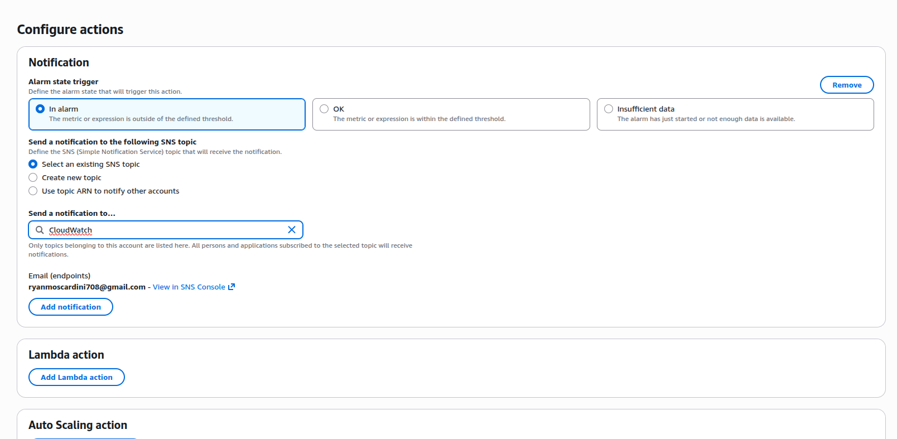

5. Após isso, basta colocar o nome e se quiser, uma mensagem que será incrementada no e-mail de alerta. 