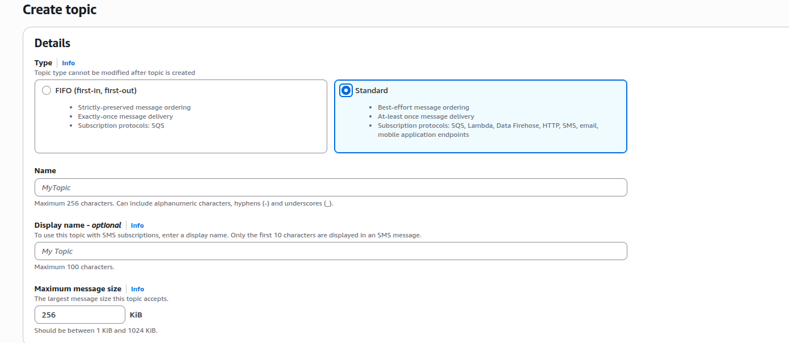
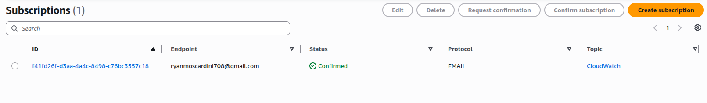

# SNS
O **Amazon SNS (Simple Notification Service)** é um serviço gerenciado de mensageria da AWS baseado no modelo **Pub/Sub (Publicador/Assinante)**.

### O que é?

É uma solução totalmente gerenciada e altamente escalável para coordenar a entrega assíncrona de mensagens de produtores (publishers) para vários consumidores (subscribers) por meio de canais chamados **Tópicos**.

### Para que serve?

* **Fan-out para microsserviços:** Distribui uma mesma mensagem para múltiplos destinos simultaneamente (como filas **SQS**, funções **AWS Lambda** e endpoints HTTP/S).
* **Desacoplamento de sistemas:** Permite que serviços conversem entre si sem conhecerem as implementações internas dos destinatários.
* **Notificações a usuários finais:** Envia alertas em massa diretamente para pessoas via **SMS**, **e-mail** e **notificações push móveis** (iOS, Android).
* **Alertas operacionais:** Integra-se nativamente a ferramentas como o CloudWatch para disparar avisos de monitoramento, alarmes de infraestrutura e falhas no sistema.

## TOPICS
O **Topic (Tópico)** é o canal lógico de comunicação e ponto de acesso central dentro do Amazon SNS.

Ele funciona como um "quadro de avisos" ou canal de distribuição:

* **Ponto de entrada:** Quem publica a mensagem (publisher) envia o payload para o tópico, sem precisar saber quem ou o que vai consumir esse dado.
* **Ponto de distribuição:** Todos os interessados (subscribers — como filas SQS, Lambdas, e-mails ou endpoints HTTP) se inscrevem no tópico para receber automaticamente uma cópia das mensagens publicadas ali.

Existem dois tipos principais de tópicos:

* **Standard:** Alta taxa de transferência e entrega de mensagens "ao menos uma vez" (*at-least-once*), mas sem garantia estrita de ordem.
* **FIFO:** Garante a ordem exata de envio e entrega estritamente uma única vez (*exactly-once*), indicado para fluxos onde a sequência das operações é crítica.

## Subscription
Uma **Subscription** é o vínculo entre um **Tópico** do SNS e um **Destino** (como SQS, Lambda, e-mail ou webhook), definindo para onde e por qual protocolo as mensagens devem ser entregues automaticamente.

**IMPORTANTE:**
Para a maioria dos endpoints (E-mail, SMS, HTTP/HTTPS e etc...) é necessário uma confirmação antes do inicio do envio.
