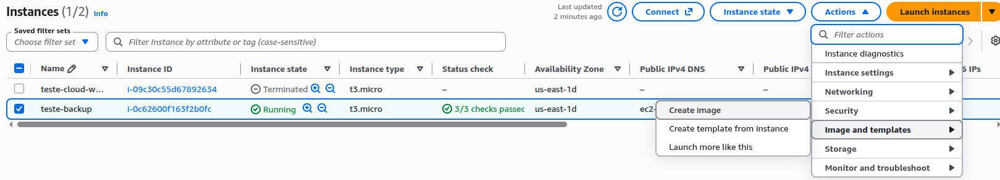
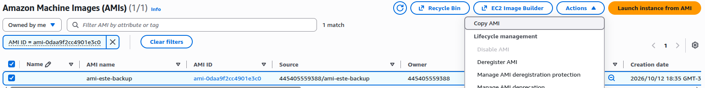
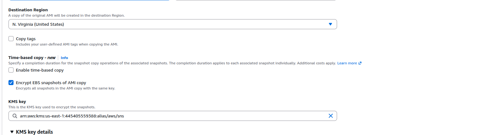

# Como criptografar volumes EBS

Será ensinado como realizar a criptografaia de volumes EBS de instancias que já estão funcionando e seus volumes EBS não estão criptografados de forma segura.

1. Criar uma AMI da instancia
   

2. Fazer um " Copy " da AMI que você acabou de gerar.

3. Durante o processo de " Copy " selecione a opção de "Encrypt EBS snapshots of AMI copy" junto de sua chave do KMS de escolha.

4. Após isso, deve subir uma instancia nova baseada na AM com o volume EBS criptografado e identica a outra.

5. Após a mesma ficar ok, vcoê deve trocar os Elastic Ip's das mesmas.
- A nova pega o IP da antiga
Ex:
- Antiga sem criptografia IP = 55.65.655.1
- Nova com criptografia IP = 1.258.65.4
Diante deste cenário, você debe tirar o IP da antiga e passar para nova, assim fica:
- Antiga sem criptografia IP = 0.0.0.0
- Nova com criptografia IP = 55.65.655.1

