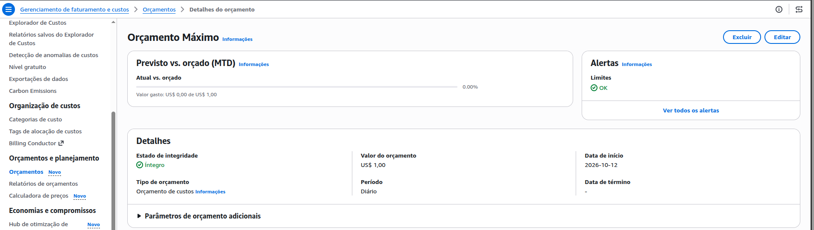

# AWS Budgets

O AWS Budgets é um serviço da AWS que permite definir limites de gastos e acompanhar se os custos da sua conta estão dentro do planejado. Ele é muito útil para quem está estudando AWS e fazendo laboratórios com EC2, RDS, CloudWatch, S3, entre outros serviços.

## Como funciona na prática?

Imagine que você está estudando AWS e definiu um orçamento mensal de US$ 10.

Orçamento mensal

# US$ 10,00
US$ 6,00 (60%)
- 50%: alerta quando os gastos atingem US$ 5.
- 80%: novo alerta ao atingir US$ 8.
- 100%: alerta ao atingir US$ 10.
- 
Os alertas podem ser enviados por e-mail e, conforme a configuração, integrados a outros serviços, como o Amazon SNS.

Atenção: o AWS Budgets monitora e alerta, mas não interrompe automaticamente os recursos quando o limite é atingido. Para automatizar ações, é necessário configurar mecanismos adicionais.

## Custos de uso

| Recurso                                 | Custo                          |
| --------------------------------------- | ------------------------------ |
| Orçamentos para monitoramento e alertas | Gratuito                       |
| Orçamentos com ações automatizadas      | Primeiros 2 gratuitos por mês  |
| Cada orçamento adicional com ações      | US$ 0,10 por dia               |
| Relatórios de orçamento por e-mail      | US$ 0,01 por relatório enviado |

## Quais tipos de orçamento existem?

- Cost Budget: acompanha o valor gasto em dólares.
- Usage Budget: monitora a utilização de serviços.
- RI Utilization/Coverage: acompanha o uso e a cobertura de instâncias reservadas.
- Savings Plans: monitora a utilização e a cobertura dos planos de economia.
