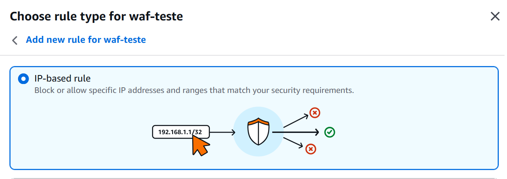
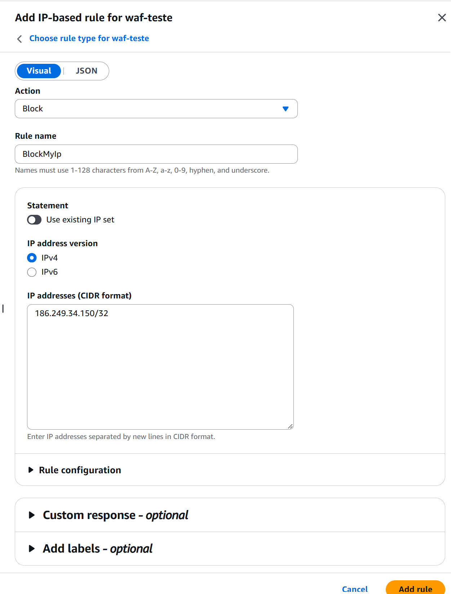
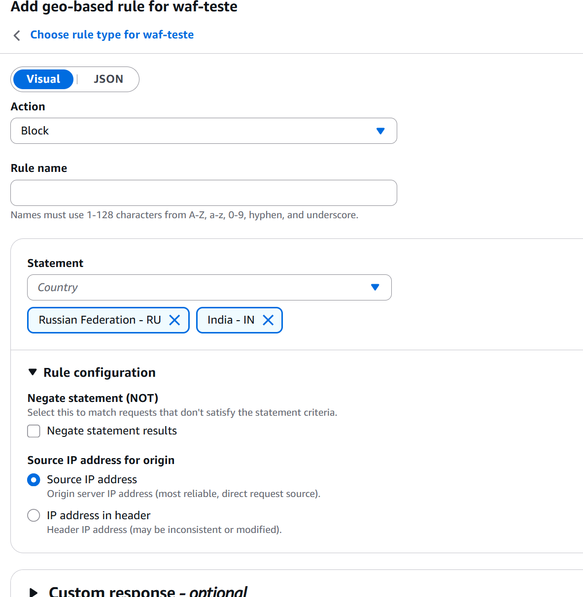
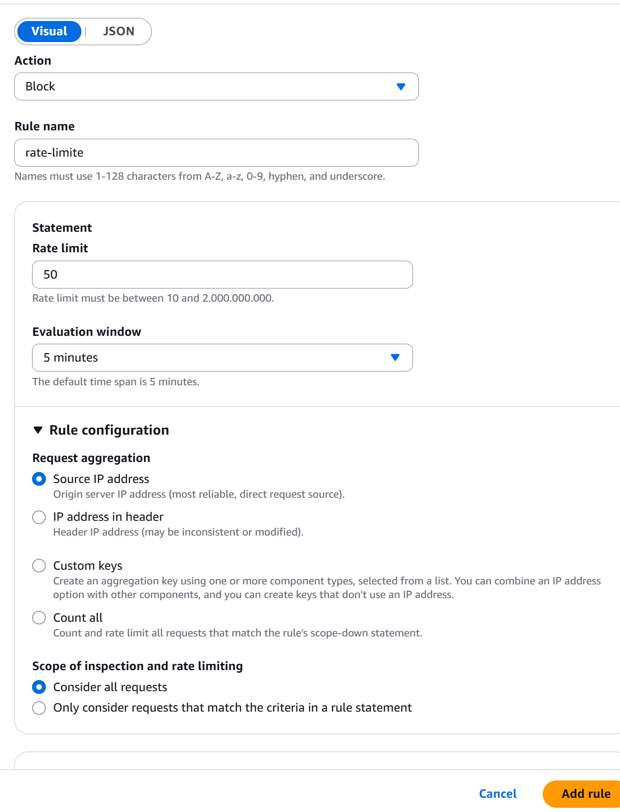

# RULES

As regras do AWS WAF são responsáveis por analisar e filtrar as requisições recebidas por uma aplicação web. Elas definem as condições que uma requisição deve atender e qual ação será executada quando essas condições forem correspondidas.

As regras são configuradas dentro de uma Web ACL (Web Access Control List), que reúne as políticas de segurança aplicadas ao recurso protegido.

As principais ações disponíveis são:

- **Allow:** permite que a requisição continue seu processamento.
- **Block:** bloqueia a requisição, impedindo que ela prossiga para a aplicação.
- **Count:** contabiliza as requisições que correspondem à regra sem bloqueá-las. É útil para testes e validação.
- **CAPTCHA:** solicita que o cliente resolva um desafio CAPTCHA.
- **Challenge:** solicita uma verificação para avaliar se o cliente consegue responder ao desafio apresentado pelo AWS WAF.

A disponibilidade das ações depende do tipo de regra e da configuração utilizada. A prioridade das regras também deve ser considerada, pois a ordem de avaliação influencia o resultado final.

Existem diferentes tipos de regras no AWS WAF. A seguir, serão apresentados quatro tipos utilizados com frequência.

## 1. IP-based Rule

As regras baseadas em IP permitem controlar o tráfego de acordo com os endereços IP de origem das requisições.

Por meio desse tipo de regra, é possível permitir ou bloquear acessos provenientes de endereços específicos ou de conjuntos de endereços IP.

### Como criar?

Na primeira etapa, selecione a opção para criar uma regra baseada em endereço IP.

Na configuração da regra, defina o nome, a ação que será executada e a origem dos endereços IP que serão avaliados.

É possível utilizar um IP set existente ou informar os endereços IP diretamente, conforme as opções disponíveis na interface de criação.

### O que é um IP set?

Um IP set é um recurso do AWS WAF utilizado para armazenar e organizar uma lista de endereços IP ou blocos de endereços IP em notação CIDR.

Em vez de cadastrar diversos endereços individualmente em várias regras, você pode criar um IP set e reutilizá-lo em diferentes regras compatíveis.

Por exemplo, você pode criar um IP set chamado `IPs_Bloqueados` e adicionar os endereços que não devem acessar a aplicação. Em seguida, uma regra pode utilizar esse conjunto para bloquear as requisições correspondentes.

**Observação:** o IP set não bloqueia nem permite o tráfego sozinho. Ele fornece os endereços que serão avaliados por uma regra, cuja ação determina o tratamento das requisições.

### Notação CIDR

Os endereços IP devem ser informados utilizando a notação CIDR (*Classless Inter-Domain Routing*), que define quantos bits do endereço representam o prefixo da rede.

Para endereços IPv4, o sufixo `/32` representa um único endereço IP. Prefixos menores abrangem intervalos maiores de endereços.

| Notação CIDR | Quantidade de endereços IPv4 | Exemplo |
|---|---:|---|
| `/32` | 1 | `203.0.113.10/32` |
| `/31` | 2 | `203.0.113.10/31` |
| `/30` | 4 | `203.0.113.8/30` |
| `/29` | 8 | `203.0.113.8/29` |
| `/24` | 256 | `203.0.113.0/24` |
| `/16` | 65.536 | `203.0.0.0/16` |
| `/8` | 16.777.216 | `203.0.0.0/8` |
| `/0` | 4.294.967.296 | `0.0.0.0/0` |

Os endereços apresentados são exemplos de documentação e não devem ser tratados como endereços de origem reais.

**Importante:** para bloquear somente um endereço IPv4, utilize `/32`. Para um único endereço IPv6, utilize `/128`. O AWS WAF também permite trabalhar com IPv6 quando o IP set e a configuração são compatíveis.

Ao utilizar prefixos amplos, tenha cuidado para não bloquear endereços legítimos de usuários, serviços ou redes inteiras.

## 2. Geo Match Rule (Geolocalização)

As regras de geolocalização permitem filtrar requisições com base na localização geográfica associada ao endereço IP de origem.

Esse recurso pode ser utilizado para restringir o acesso de determinados países ou estabelecer uma política de acesso direcionada a regiões específicas.

Por exemplo, você pode bloquear requisições identificadas como provenientes da Rússia e da Índia. Outra possibilidade é restringir o acesso à aplicação para permitir somente o tráfego identificado como originado no Brasil.

A ação escolhida determina o comportamento da regra:

- **Block:** bloqueia as requisições que correspondem aos países selecionados.
- **Allow:** permite as requisições que correspondem aos países selecionados, respeitando a ordem e o processamento das regras da Web ACL.
- **Count:** contabiliza as correspondências sem bloquear as requisições.

### Exemplo prático

Imagine que uma aplicação seja destinada exclusivamente ao público brasileiro.

Uma possibilidade é criar uma regra de geolocalização para identificar requisições provenientes de outros países e bloqueá-las.

Outra abordagem é utilizar uma regra que permita somente requisições identificadas como originadas no Brasil. Entretanto, é necessário ter cuidado com a ação Allow, pois ela pode encerrar a avaliação das demais regras da Web ACL e impedir que verificações posteriores sejam executadas para aquela requisição.

Por isso, a estratégia escolhida deve considerar a prioridade das regras e os demais controles de segurança existentes.

**Observação:** a geolocalização é estimada a partir do endereço IP e não garante a identificação exata da localização física do usuário. VPNs, proxies e outras tecnologias podem influenciar o resultado.

## 3. Rate-based Rule (Limitação de requisições)

As regras baseadas em taxa (*Rate-based Rules*) permitem identificar e controlar clientes que enviam um volume elevado de requisições durante determinado intervalo de tempo.

Esse mecanismo é útil para reduzir abusos, limitar acessos automatizados e ajudar a mitigar determinados padrões de tráfego excessivo.

Por exemplo, você pode configurar uma regra para identificar um endereço IP que ultrapasse um limite de 100 requisições dentro de uma janela de avaliação de um minuto. Quando o limite é excedido, o AWS WAF pode aplicar a ação configurada, como Block.

### Como funciona?

Ao criar uma regra baseada em taxa, você define os critérios utilizados para agrupar e contabilizar as requisições, além do limite de requisições e da ação a ser aplicada.

O AWS WAF acompanha as requisições que correspondem aos critérios configurados e aplica a ação definida aos grupos que ultrapassam o limite.

A contagem é baseada em uma janela de avaliação. Portanto, o bloqueio não ocorre necessariamente de forma instantânea ou exatamente no momento em que uma requisição ultrapassa o limite. O AWS WAF atualiza continuamente a avaliação da taxa.

### Combinação com outras condições

Uma regra baseada em taxa pode ser combinada com outras condições de correspondência para tornar o controle mais específico.

Por exemplo, imagine que você queira controlar o acesso ao caminho `/admin` e bloquear um endereço IP que ultrapasse determinado limite de requisições nesse endpoint.

A configuração pode considerar:

- **Condição de correspondência:** requisições destinadas ao caminho `/admin`.
- **Limite de taxa:** um valor definido de acordo com o comportamento esperado da aplicação.
- **Agregação:** por endereço IP de origem.
- **Ação:** Block.

Dessa forma, quando um endereço IP ultrapassar o limite configurado para as requisições correspondentes ao caminho `/admin`, o AWS WAF poderá bloquear temporariamente as requisições desse grupo.

O limite mínimo permitido, as janelas de avaliação disponíveis e as opções de agregação dependem das capacidades atuais do AWS WAF.

### O que acontece quando o bloqueio é aplicado?

Quando uma regra baseada em taxa utiliza a ação Block, as requisições correspondentes são bloqueadas enquanto o mecanismo de avaliação considerar que o grupo está acima do limite configurado.

**Importante:** remover a regra ou alterar sua configuração não equivale a liberar instantaneamente todas as requisições. Se o bloqueio for causado por uma regra baseada em taxa, o acesso poderá voltar quando o AWS WAF deixar de considerar aquele grupo acima do limite.

O tempo de recuperação depende do comportamento do tráfego e da janela de avaliação. Portanto, não se trata necessariamente de um bloqueio fixo que termina após um número exato de minutos.

## 4. Custom Rules (Regras personalizadas)

As regras personalizadas permitem criar condições específicas de filtragem de acordo com as necessidades da aplicação.

Elas são úteis quando as regras baseadas em IP, geolocalização ou taxa não atendem completamente ao cenário de segurança desejado.

Com esse tipo de regra, é possível combinar diferentes critérios de inspeção para identificar requisições que apresentem determinadas características.

### Exemplos de utilização

**Bloqueio de caminhos específicos**

Você pode bloquear requisições destinadas a caminhos que não deveriam estar acessíveis publicamente, conforme a arquitetura da aplicação.

Exemplo: bloquear o acesso externo a um endpoint administrativo.

**Inspeção de parâmetros e cabeçalhos**

É possível avaliar os parâmetros da URL, os cabeçalhos HTTP e outras partes da requisição para identificar padrões específicos.

**Proteção contra padrões de ataque**

O AWS WAF permite utilizar instruções de inspeção para identificar padrões associados a ataques como SQL Injection e Cross-Site Scripting (XSS). Também é possível utilizar grupos de regras gerenciadas para complementar essa proteção.

**Combinação de condições**

Você pode combinar condições com operadores lógicos, como AND, OR e NOT, de acordo com as instruções de regra disponíveis.

Por exemplo, uma regra pode identificar requisições destinadas ao caminho `/admin` que também apresentem determinado método HTTP ou outra característica considerada indesejada.

### Exemplo prático

Imagine que uma aplicação disponibilize um painel administrativo no caminho `/admin`, mas que esse painel deva aceitar somente requisições HTTP GET.

Uma regra personalizada pode avaliar o caminho da requisição e o método HTTP utilizado. Quando uma requisição corresponder ao caminho `/admin` e utilizar um método diferente de GET, a regra poderá aplicar a ação Block.

A condição deve ser configurada corretamente para que outras rotas e métodos legítimos da aplicação não sejam afetados.

### Cuidados na implementação

As regras personalizadas oferecem flexibilidade, mas precisam ser testadas antes de serem aplicadas em produção.

Regras muito abrangentes podem bloquear requisições legítimas, enquanto regras excessivamente restritivas podem deixar de identificar tráfego indesejado.

Quando houver dúvidas sobre o impacto de uma regra, utilize Count para observar as correspondências antes de aplicar uma ação de bloqueio.

